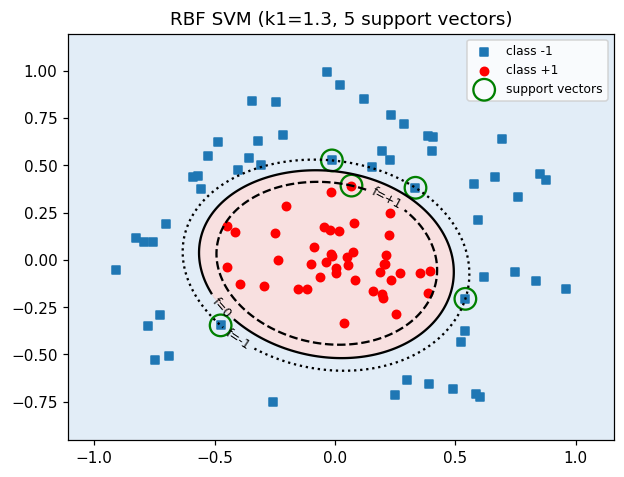

# SVM from Scratch —— 支持向量机的数学原理与 SMO 实现

本项目是《机器学习实战》(*Machine Learning in Action*, Peter Harrington) 第 6 章「支持向量机」的 Python 3 实现与扩展：

- 用纯 NumPy 从零实现 **简化版 SMO** 和 **完整 Platt SMO**，支持线性核与 RBF 核；
- 在二维线性可分数据、二维非线性数据（环形）以及手写数字（"是不是 9"）上做实验；
- 用 scikit-learn 的 `SVC`（基于 libsvm）作为对照，并**可视化决策边界 $`f=0`$ 与间隔边界 $`f=\pm1`$**；
- 本 README 从零推导 SVM 的数学原理：间隔 → 原始问题 → 拉格朗日对偶 → KKT → 软间隔 → 核技巧 → SMO 的每一步更新公式，并把每个公式对应到代码。

| 线性 SVM（`smoP`，线性核） | RBF SVM（书中 SMO） | RBF SVM（scikit-learn） |
|:---:|:---:|:---:|
|  |  |  |

---

## 目录

1. [问题设定](#1-问题设定)
2. [函数间隔与几何间隔](#2-函数间隔与几何间隔)
3. [硬间隔 SVM：原始问题](#3-硬间隔-svm原始问题)
4. [拉格朗日对偶](#4-拉格朗日对偶)
5. [KKT 条件与支持向量](#5-kkt-条件与支持向量)
6. [软间隔 SVM 与参数 C](#6-软间隔-svm-与参数-c)
7. [核技巧](#7-核技巧)
8. [SMO 算法详细推导](#8-smo-算法详细推导)
9. [公式与代码对照表](#9-公式与代码对照表)
10. [实验结果](#10-实验结果)
11. [为什么书中 SMO 的支持向量不在 f=±1 上？](#11-为什么书中-smo-的支持向量不在-f1-上)
12. [项目结构与运行方法](#12-项目结构与运行方法)
13. [参考资料与致谢](#13-参考资料与致谢)

---

## 1. 问题设定

给定训练集

```math
\mathcal{D} = \{(\mathbf{x}_1, y_1), \dots, (\mathbf{x}_m, y_m)\},\qquad \mathbf{x}_i \in \mathbb{R}^n,\; y_i \in \{-1, +1\}
```

我们要找一个超平面 $`\mathbf{w}^\top\mathbf{x} + b = 0`$ 把两类分开，并用

```math
f(\mathbf{x}) = \mathbf{w}^\top\mathbf{x} + b,\qquad \hat{y} = \mathrm{sign}\big(f(\mathbf{x})\big)
```

做预测。注意 SVM 的标签取 $`\pm1`$ 而不是 $`0/1`$，这样 "分类正确" 可以统一写成 $`y_i f(\mathbf{x}_i) > 0`$，后面的推导会简洁很多。

能把线性可分数据分开的超平面有无穷多个。SVM 的核心思想是：**选择离两类样本都"最远"的那一个**，即最大化间隔（margin）。直觉上，间隔越大，对噪声和新样本的容忍度越高，泛化能力越好（统计学习理论中，间隔越大，VC 维上界越小）。

## 2. 函数间隔与几何间隔

**函数间隔**（functional margin）：

```math
\hat{\gamma}_i = y_i(\mathbf{w}^\top\mathbf{x}_i + b)
```

它为正表示分类正确，数值越大越"确信"。但它有个问题：把 $`(\mathbf{w}, b)`$ 同时乘以 2，超平面不变，函数间隔却翻倍。所以函数间隔不能直接拿来最大化。

**几何间隔**（geometric margin）：点 $`\mathbf{x}_i`$ 到超平面的欧氏距离（带符号）

```math
\gamma_i = \frac{y_i(\mathbf{w}^\top\mathbf{x}_i + b)}{\lVert\mathbf{w}\rVert} = \frac{\hat{\gamma}_i}{\lVert\mathbf{w}\rVert}
```

推导：设 $`\mathbf{x}_0`$ 是 $`\mathbf{x}_i`$ 在超平面上的投影，则 $`\mathbf{x}_i = \mathbf{x}_0 + \gamma_i \, y_i \frac{\mathbf{w}}{\lVert\mathbf{w}\rVert}`$。代入 $`\mathbf{w}^\top\mathbf{x}_0 + b = 0`$ 即得上式。几何间隔对 $`(\mathbf{w}, b)`$ 的缩放不变。

整个数据集的间隔定义为所有样本几何间隔的最小值：$`\gamma = \min_i \gamma_i`$。

## 3. 硬间隔 SVM：原始问题

最大化间隔：

```math
\max_{\mathbf{w}, b}\; \frac{\hat{\gamma}}{\lVert\mathbf{w}\rVert}\quad \text{s.t.}\quad y_i(\mathbf{w}^\top\mathbf{x}_i + b) \ge \hat{\gamma},\; i = 1,\dots,m
```

由于 $`(\mathbf{w}, b)`$ 可以任意缩放，我们**固定函数间隔 $`\hat{\gamma} = 1`$**（这就是"$`f = \pm1`$"这两条间隔边界的来源）。于是最大化 $`1/\lVert\mathbf{w}\rVert`$ 等价于最小化 $`\frac{1}{2}\lVert\mathbf{w}\rVert^2`$（平方和系数 $`\frac12`$ 只是为了求导方便）：

```math
\boxed{\;\min_{\mathbf{w}, b}\; \frac{1}{2}\lVert\mathbf{w}\rVert^2 \quad \text{s.t.}\quad y_i(\mathbf{w}^\top\mathbf{x}_i + b) \ge 1,\; i = 1,\dots,m\;}
```

这是一个**凸二次规划**（目标是凸二次函数，约束是线性的），有唯一的最优 $`\mathbf{w}^{\star}`$。此时两条间隔边界 $`f(\mathbf{x}) = \pm1`$ 之间的宽度为 $`\dfrac{2}{\lVert\mathbf{w}\rVert}`$。

## 4. 拉格朗日对偶

为什么要转到对偶问题？两个原因：

1. 对偶问题只依赖样本之间的**内积** $`\mathbf{x}_i^\top\mathbf{x}_j`$，这让我们可以引入**核函数**（第 7 节）；
2. 对偶问题的变量个数是样本数 $`m`$，且约束形式非常简单，适合用 SMO 这样的坐标式方法求解。

### 4.1 拉格朗日函数

对每个约束引入乘子 $`\alpha_i \ge 0`$：

```math
\mathcal{L}(\mathbf{w}, b, \boldsymbol{\alpha}) = \frac{1}{2}\lVert\mathbf{w}\rVert^2 - \sum_{i=1}^{m}\alpha_i\Big[y_i(\mathbf{w}^\top\mathbf{x}_i + b) - 1\Big]
```

原始问题等价于 $`\min_{\mathbf{w},b}\max_{\boldsymbol{\alpha}\ge 0}\mathcal{L}`$：若某个约束被违反，对应的 $`\alpha_i \to \infty`$ 会让 $`\mathcal{L} \to \infty`$；若约束都满足，最大值就是 $`\frac12\lVert\mathbf{w}\rVert^2`$。

对偶问题是交换 min 与 max：$`\max_{\boldsymbol{\alpha}\ge 0}\min_{\mathbf{w},b}\mathcal{L}`$。由于原始问题是凸的且约束是线性的（满足 Slater 条件），**强对偶成立**，两者最优值相同。

### 4.2 对 w、b 求极小

```math
\frac{\partial \mathcal{L}}{\partial \mathbf{w}} = \mathbf{w} - \sum_i \alpha_i y_i \mathbf{x}_i = 0 \;\;\Longrightarrow\;\; \boxed{\mathbf{w} = \sum_{i=1}^{m}\alpha_i y_i \mathbf{x}_i}
```

```math
\frac{\partial \mathcal{L}}{\partial b} = -\sum_i \alpha_i y_i = 0 \;\;\Longrightarrow\;\; \boxed{\sum_{i=1}^{m}\alpha_i y_i = 0}
```

第一个式子说明：**$`\mathbf{w}`$ 是训练样本的线性组合**。代码中的 `calcWs` 就是在计算它。

### 4.3 对偶问题

把上面两式代回 $`\mathcal{L}`$：

```math
\begin{aligned}
\mathcal{L} &= \frac12\sum_{i,j}\alpha_i\alpha_j y_i y_j\,\mathbf{x}_i^\top\mathbf{x}_j - \sum_{i,j}\alpha_i\alpha_j y_i y_j\,\mathbf{x}_i^\top\mathbf{x}_j - b\underbrace{\sum_i\alpha_i y_i}_{=0} + \sum_i\alpha_i \\
&= \sum_i\alpha_i - \frac12\sum_{i,j}\alpha_i\alpha_j y_i y_j\,\mathbf{x}_i^\top\mathbf{x}_j
\end{aligned}
```

得到**对偶问题**：

```math
\boxed{\;\max_{\boldsymbol{\alpha}}\; W(\boldsymbol{\alpha}) = \sum_{i=1}^{m}\alpha_i - \frac{1}{2}\sum_{i=1}^{m}\sum_{j=1}^{m}\alpha_i\alpha_j y_i y_j\,\langle\mathbf{x}_i, \mathbf{x}_j\rangle
\quad\text{s.t.}\quad \alpha_i \ge 0,\;\; \sum_{i=1}^{m}\alpha_i y_i = 0\;}
```

求出 $`\boldsymbol{\alpha}`$ 后，决策函数为

```math
f(\mathbf{x}) = \sum_{i=1}^{m}\alpha_i y_i\,\langle\mathbf{x}_i, \mathbf{x}\rangle + b
```

## 5. KKT 条件与支持向量

强对偶下，最优解必须满足 KKT 条件：

```math
\begin{aligned}
&\text{原始可行：} && y_i f(\mathbf{x}_i) - 1 \ge 0 \\
&\text{对偶可行：} && \alpha_i \ge 0 \\
&\text{互补松弛：} && \alpha_i\big[y_i f(\mathbf{x}_i) - 1\big] = 0
\end{aligned}
```

**互补松弛**是理解 SVM 的关键：对每个样本，要么 $`\alpha_i = 0`$，要么 $`y_i f(\mathbf{x}_i) = 1`$。

- $`\alpha_i = 0`$ 的样本对 $`\mathbf{w}`$ 毫无贡献，删掉它们，解不变；
- $`\alpha_i > 0`$ 的样本必然恰好落在间隔边界 $`f(\mathbf{x}) = \pm1`$ 上，它们**"支撑"起了整个超平面**，因此称为**支持向量**。

这就是 SVM 的**稀疏性**：最终模型只依赖少数支持向量。代码里用 `nonzero(alphas.A > 0)` 取出它们。

**求 b**：任取一个支持向量 $`\mathbf{x}_s`$，由 $`y_s f(\mathbf{x}_s) = 1`$ 且 $`y_s^2 = 1`$ 得

```math
b = y_s - \sum_i \alpha_i y_i\,\langle\mathbf{x}_i, \mathbf{x}_s\rangle
```

数值上更稳健的做法是对所有（非边界）支持向量求平均。

## 6. 软间隔 SVM 与参数 C

现实数据往往不是线性可分的，或者存在噪声/离群点。硬间隔要求所有点都在间隔外，此时无解或解很差。

### 6.1 引入松弛变量

允许每个样本有一定的"违约量" $`\xi_i \ge 0`$，但要为此付出代价 $`C\xi_i`$：

```math
\boxed{\;\min_{\mathbf{w}, b, \boldsymbol{\xi}}\; \frac{1}{2}\lVert\mathbf{w}\rVert^2 + C\sum_{i=1}^{m}\xi_i
\quad\text{s.t.}\quad y_i(\mathbf{w}^\top\mathbf{x}_i + b) \ge 1 - \xi_i,\;\; \xi_i \ge 0\;}
```

- $`\xi_i = 0`$：样本在间隔外（或间隔边界上）；
- $`0 < \xi_i \le 1`$：样本在间隔内，但仍分类正确；
- $`\xi_i > 1`$：样本被分错。

### 6.2 软间隔的对偶

对两组约束分别引入 $`\alpha_i \ge 0`$、$`\mu_i \ge 0`$：

```math
\mathcal{L} = \frac12\lVert\mathbf{w}\rVert^2 + C\sum_i\xi_i - \sum_i\alpha_i\big[y_i(\mathbf{w}^\top\mathbf{x}_i + b) - 1 + \xi_i\big] - \sum_i\mu_i\xi_i
```

对 $`\mathbf{w}`$、$`b`$ 求导结果与硬间隔相同，多出一个：

```math
\frac{\partial\mathcal{L}}{\partial\xi_i} = C - \alpha_i - \mu_i = 0 \;\;\Longrightarrow\;\; \mu_i = C - \alpha_i \ge 0 \;\;\Longrightarrow\;\; \alpha_i \le C
```

代回后 $`\xi_i`$ 和 $`\mu_i`$ 全部消掉，对偶问题与硬间隔**完全一样**，只是 $`\alpha_i`$ 多了一个上界：

```math
\boxed{\;\max_{\boldsymbol{\alpha}}\; \sum_{i}\alpha_i - \frac{1}{2}\sum_{i,j}\alpha_i\alpha_j y_i y_j\,K(\mathbf{x}_i, \mathbf{x}_j)
\quad\text{s.t.}\quad 0 \le \alpha_i \le C,\;\; \sum_{i}\alpha_i y_i = 0\;}
```

（这里已经把内积换成了核函数 $`K`$，见第 7 节。）这个"盒约束" $`0 \le \alpha_i \le C`$ 就是代码里 `clipAlpha` 和 `L`、`H` 的来源。

### 6.3 软间隔的 KKT 条件

结合 $`\alpha_i[y_if_i - 1 + \xi_i] = 0`$ 和 $`\mu_i\xi_i = (C - \alpha_i)\xi_i = 0`$，可以得到三种情况：

| $`\alpha_i`$ 的取值 | 推出的 $`y_i f(\mathbf{x}_i)`$ | 样本位置 | 是否支持向量 |
|---|---|---|---|
| $`\alpha_i = 0`$ | $`\ge 1`$ | 间隔边界之外（正确分类） | 否 |
| $`0 < \alpha_i < C`$ | $`= 1`$ | **恰好在 $`f = \pm1`$ 上** | 是（"自由"支持向量） |
| $`\alpha_i = C`$ | $`\le 1`$ | 间隔内部，甚至被分错 | 是（"边界"支持向量） |

**这张表是检验求解器是否收敛的标准**：只有 $`\alpha_i = C`$ 的支持向量才允许离开 $`f = \pm1`$。代码中的 KKT 检查写成误差形式：令 $`E_i = f(\mathbf{x}_i) - y_i`$，则 $`y_iE_i = y_if(\mathbf{x}_i) - 1`$，于是

- $`y_iE_i < 0`$（点在间隔内）却 $`\alpha_i < C`$ → 违反 KKT；
- $`y_iE_i > 0`$（点在间隔外）却 $`\alpha_i > 0`$ → 违反 KKT。

对应代码：

```python
if ((labelMat[i]*Ei < -toler) and (alphas[i] < C)) or ((labelMat[i]*Ei > toler) and (alphas[i] > 0)):
```

`toler` 是数值容差。

### 6.4 等价形式：合页损失

由约束可知最优时 $`\xi_i = \max\big(0,\, 1 - y_if(\mathbf{x}_i)\big)`$，代回目标函数：

```math
\min_{\mathbf{w}, b}\; \sum_{i=1}^{m}\underbrace{\max\big(0,\; 1 - y_i f(\mathbf{x}_i)\big)}_{\text{hinge loss}} + \frac{1}{2C}\lVert\mathbf{w}\rVert^2
```

所以软间隔 SVM = **合页损失 + L2 正则**。$`C`$ 是正则强度的倒数：

- $`C`$ 大 → 强烈惩罚违约，接近硬间隔，间隔窄、容易过拟合；
- $`C`$ 小 → 允许更多违约，间隔宽、更平滑，可能欠拟合。

## 7. 核技巧

### 7.1 思想

对偶问题和决策函数里，样本只以内积 $`\langle\mathbf{x}_i, \mathbf{x}_j\rangle`$ 的形式出现。如果先用映射 $`\phi: \mathbb{R}^n \to \mathcal{H}`$ 把数据送到高维（甚至无穷维）特征空间，在那里做线性 SVM，就只需要计算 $`\langle\phi(\mathbf{x}_i), \phi(\mathbf{x}_j)\rangle`$。**核函数**直接给出这个内积，而不必显式计算 $`\phi`$：

```math
K(\mathbf{x}, \mathbf{z}) = \langle\phi(\mathbf{x}), \phi(\mathbf{z})\rangle
```

于是决策函数变为

```math
\boxed{\; f(\mathbf{x}) = \sum_{i \in \text{SV}}\alpha_i y_i\,K(\mathbf{x}_i, \mathbf{x}) + b \;}
```

它在原空间里是非线性的。代码 `testRbf` 中的预测就是这一行：

```python
predict = kernelEval.T * multiply(labelSV, alphas[svInd]) + b
```

### 7.2 什么函数能当核？（Mercer 定理）

$`K`$ 是合法核，当且仅当对任意有限样本集，**核矩阵（Gram 矩阵）$`\mathbf{K}_{ij} = K(\mathbf{x}_i, \mathbf{x}_j)`$ 对称半正定**。这保证了对偶问题仍是凸的（目标函数是凹的），有全局最优。

### 7.3 本项目用到的核

`kernelTrans(X, A, kTup)` 支持两种核：

| 核 | 公式 | 代码参数 |
|---|---|---|
| 线性核 | $`K(\mathbf{x}, \mathbf{z}) = \mathbf{x}^\top\mathbf{z}`$ | `('lin', 0)` |
| 高斯 RBF 核 | $`K(\mathbf{x}, \mathbf{z}) = \exp\!\left(-\dfrac{\lVert\mathbf{x} - \mathbf{z}\rVert^2}{k_1^2}\right)`$ | `('rbf', k1)` |

注意：书中的 RBF 写法分母是 $`k_1^2`$，而不是教科书常见的 $`2\sigma^2`$。换到 scikit-learn 时，对应 `gamma = 1 / k1**2`（见 `testRbfSklearn`）。

**RBF 核对应无穷维特征空间。** 以一维为例（取 $`k_1^2 = 2\sigma^2`$ 记号）：

```math
e^{-\frac{(x - z)^2}{2\sigma^2}} = e^{-\frac{x^2}{2\sigma^2}}e^{-\frac{z^2}{2\sigma^2}}\sum_{k=0}^{\infty}\frac{1}{k!}\left(\frac{xz}{\sigma^2}\right)^k
```

展开后每一项都是 $`x^k`$ 与 $`z^k`$ 的乘积，即 $`\phi(x)`$ 含有所有阶的多项式特征。

**$`k_1`$ 的作用**（带宽）：

- $`k_1`$ 小 → 核衰减快，每个支持向量只影响很小的邻域，边界弯曲复杂，支持向量多，易过拟合；
- $`k_1`$ 大 → 核很平，边界接近线性/低阶多项式，易欠拟合。

## 8. SMO 算法详细推导

对偶问题是一个有 $`m`$ 个变量的二次规划。通用 QP 求解器需要存储 $`m \times m`$ 的核矩阵并做矩阵分解，规模一大就吃不消。**SMO（Sequential Minimal Optimization，Platt 1998）** 的思路是：每次只优化**两个**变量，其余固定，而两变量子问题有**解析解**。

### 8.1 为什么是两个变量？

约束 $`\sum_i\alpha_iy_i = 0`$ 意味着：如果只改一个 $`\alpha_i`$，其它都不动，这个等式就被破坏了。所以最少要同时改两个。

### 8.2 两变量子问题

选定 $`\alpha_i, \alpha_j`$，其余固定。等式约束变为

```math
\alpha_i y_i + \alpha_j y_j = -\sum_{k \ne i,j}\alpha_k y_k = \text{常数}
```

两边乘以 $`y_i`$，记 $`s = y_iy_j`$：

```math
\alpha_i + s\,\alpha_j = \text{常数} \;\;\Longrightarrow\;\; \alpha_i = \text{常数} - s\,\alpha_j
```

记 $`K_{ij} = K(\mathbf{x}_i, \mathbf{x}_j)`$，$`v_i = \sum_{k \ne i,j}\alpha_k y_k K_{ik} = f(\mathbf{x}_i) - b - \alpha_i y_i K_{ii} - \alpha_j y_j K_{ij}`$。目标函数中只与 $`\alpha_i, \alpha_j`$ 有关的部分是

```math
W(\alpha_i, \alpha_j) = \alpha_i + \alpha_j - \frac12 K_{ii}\alpha_i^2 - \frac12 K_{jj}\alpha_j^2 - s K_{ij}\alpha_i\alpha_j - y_i\alpha_i v_i - y_j\alpha_j v_j + \text{常数}
```

把 $`\alpha_i = \text{常数} - s\alpha_j`$ 代入，$`W`$ 变成 $`\alpha_j`$ 的一元二次函数。

### 8.3 未剪辑的最优解

对 $`\alpha_j`$ 求导并令其为零，再把 $`v_i, v_j`$ 用旧的 $`f(\mathbf{x}_i), f(\mathbf{x}_j)`$ 表示，整理后得到一个非常漂亮的结果。定义

```math
E_k = f(\mathbf{x}_k) - y_k \quad\text{（预测误差）}, \qquad
\eta = K_{ii} + K_{jj} - 2K_{ij} = \lVert\phi(\mathbf{x}_i) - \phi(\mathbf{x}_j)\rVert^2 \ge 0
```

则

```math
\boxed{\;\alpha_j^{\text{new, unc}} = \alpha_j^{\text{old}} + \frac{y_j\,(E_i - E_j)}{\eta}\;}
```

$`W`$ 对 $`\alpha_j`$ 的二阶导是 $`-\eta`$，所以 $`\eta > 0`$ 时 $`W`$ 是开口向下的抛物线，上面的驻点就是最大值。$`\eta = 0`$（两个样本在特征空间重合）时退化，代码直接跳过这一对。

> **代码约定**：代码中 `eta = 2*K[i,j] - K[i,i] - K[j,j]`，即 $`-\eta`$，所以条件写成 `if eta >= 0: return 0`，更新写成 `alphas[j] -= labelMat[j]*(Ei - Ej)/eta`，与上式等价。

### 8.4 剪辑：满足盒约束

$`(\alpha_i, \alpha_j)`$ 必须同时落在正方形 $`[0, C]^2`$ 内，且在直线 $`\alpha_i + s\alpha_j = \text{常数}`$ 上，所以 $`\alpha_j`$ 只能在一条线段上移动，范围记为 $`[L, H]`$：

- 当 $`y_i \ne y_j`$（$`s = -1`$，直线 $`\alpha_j - \alpha_i = \text{常数}`$）：

```math
L = \max(0,\; \alpha_j - \alpha_i),\qquad H = \min(C,\; C + \alpha_j - \alpha_i)
```

- 当 $`y_i = y_j`$（$`s = +1`$，直线 $`\alpha_i + \alpha_j = \text{常数}`$）：

```math
L = \max(0,\; \alpha_i + \alpha_j - C),\qquad H = \min(C,\; \alpha_i + \alpha_j)
```

然后剪辑：

```math
\alpha_j^{\text{new}} = \begin{cases} H, & \alpha_j^{\text{new, unc}} > H \\ \alpha_j^{\text{new, unc}}, & L \le \alpha_j^{\text{new, unc}} \le H \\ L, & \alpha_j^{\text{new, unc}} < L \end{cases}
```

这就是 `clipAlpha(aj, H, L)`。若 $`L = H`$，线段退化成一个点，无法优化，跳过。

### 8.5 更新 αᵢ

由等式约束保持不变：

```math
\alpha_i^{\text{new}} = \alpha_i^{\text{old}} + y_iy_j\left(\alpha_j^{\text{old}} - \alpha_j^{\text{new}}\right)
```

对应 `alphas[i] += labelMat[j]*labelMat[i]*(alphaJold - alphas[j])`。

### 8.6 更新 b

记 $`\Delta\alpha_i = \alpha_i^{\text{new}} - \alpha_i^{\text{old}}`$，$`\Delta\alpha_j`$ 同理。更新后 $`f(\mathbf{x}_i)`$ 的变化为

```math
f^{\text{new}}(\mathbf{x}_i) = f^{\text{old}}(\mathbf{x}_i) + \Delta\alpha_i y_i K_{ii} + \Delta\alpha_j y_j K_{ij} + (b^{\text{new}} - b^{\text{old}})
```

如果 $`0 < \alpha_i^{\text{new}} < C`$，由 KKT 它应恰好在间隔边界上，即 $`f^{\text{new}}(\mathbf{x}_i) = y_i`$。利用 $`E_i = f^{\text{old}}(\mathbf{x}_i) - y_i`$ 解出

```math
b_1 = b^{\text{old}} - E_i - y_i\,\Delta\alpha_i\,K_{ii} - y_j\,\Delta\alpha_j\,K_{ij}
```

同理由 $`f^{\text{new}}(\mathbf{x}_j) = y_j`$：

```math
b_2 = b^{\text{old}} - E_j - y_i\,\Delta\alpha_i\,K_{ij} - y_j\,\Delta\alpha_j\,K_{jj}
```

取值规则：

```math
b^{\text{new}} = \begin{cases} b_1, & 0 < \alpha_i^{\text{new}} < C \\ b_2, & 0 < \alpha_j^{\text{new}} < C \\ (b_1 + b_2)/2, & \text{否则（两者都在边界上，区间内任意值都满足 KKT）} \end{cases}
```

与 `innerL` 中的 `b1`、`b2` 逐项对应。

### 8.7 怎么选这两个变量？（启发式）

SMO 的收敛速度主要取决于变量选择。

**外层循环——选 $`\alpha_i`$**（`smoP`）：

- 在"遍历全部样本"和"只遍历非边界样本 $`0 < \alpha_i < C`$"之间交替进行；
- 非边界样本最可能违反 KKT，也最可能在优化中移动，所以大部分时间花在它们上面；
- 当非边界样本一轮下来没有任何更新，再遍历一次全集；全集也没有更新时停止。

**内层循环——选 $`\alpha_j`$**（`selectJ`）：

由 8.3 节，步长正比于 $`|E_i - E_j|`$，所以选**使 $`|E_i - E_j|`$ 最大的 $`j`$**，让每一步尽可能走得远。为了不每次都重新计算所有 $`E_k`$，代码维护了误差缓存 `eCache`（第一列是有效标志，第二列是 $`E_k`$），每次更新 $`\alpha`$ 后调用 `updateEk` 刷新。

**简化版 SMO**（`smoSimple`）：外层顺序遍历所有样本，内层用 `selectJrand` **随机**选 $`j`$；当连续 `maxIter` 轮没有任何更新时停止。易懂，但在大数据上很慢。

### 8.8 完整流程

```
初始化 α = 0, b = 0
repeat:
    对外层选出的每个 i:
        计算 E_i；若 i 不违反 KKT（在容差 toler 内），跳过
        用 |E_i − E_j| 最大的启发式选 j，计算 E_j
        计算 L, H；若 L == H 跳过
        计算 η；若 η ≤ 0 跳过
        α_j ← clip(α_j + y_j(E_i − E_j)/η, L, H)
        若 α_j 变化太小，跳过
        α_i ← α_i + y_i y_j (α_j_old − α_j)
        按 8.6 节更新 b，刷新误差缓存
until 一整轮没有 α 被更新 或 达到 maxIter
```

## 9. 公式与代码对照表

| 数学对象 | 公式 | 代码位置（`svmMLiA.py`） |
|---|---|---|
| 核函数 | $`K(\mathbf{x}, \mathbf{z})`$ | `kernelTrans` |
| 核矩阵 | $`\mathbf{K}_{ij} = K(\mathbf{x}_i, \mathbf{x}_j)`$ | `optStruct.K`（初始化时一次算好） |
| 预测误差 | $`E_k = f(\mathbf{x}_k) - y_k`$ | `calcEk`、`eCache`、`updateEk` |
| KKT 违反检查 | 第 6.3 节 | `innerL` / `smoSimple` 开头的 `if` |
| 选第二个变量 | $`\arg\max_j \lvert E_i - E_j\rvert`$ | `selectJ`（随机版 `selectJrand`） |
| 盒约束区间 | $`L, H`$ | `innerL` 中的 `L`、`H` |
| 二阶导 | $`-\eta = 2K_{ij} - K_{ii} - K_{jj}`$ | `eta` |
| 剪辑 | $`\mathrm{clip}(\alpha_j, L, H)`$ | `clipAlpha` |
| 偏置 | $`b_1, b_2`$ | `b1`、`b2` |
| 外层循环 | 全集 / 非边界交替 | `smoP` |
| 权重向量（线性核） | $`\mathbf{w} = \sum_i\alpha_iy_i\mathbf{x}_i`$ | `calcWs` |
| 决策函数 | $`f(\mathbf{x}) = \sum_{i\in\text{SV}}\alpha_iy_iK(\mathbf{x}_i, \mathbf{x}) + b`$ | `testRbf`、`testDigits`、`plotRbf` |

另外，文件后半部分的 `optStructK` / `innerLK` / `smoPK` 是**不使用核缓存**的线性版本，直接用 `X[i,:]*X[j,:].T` 计算内积，便于对照理解。

## 10. 实验结果

> SMO 选第一个 $`j`$ 时有随机性，每次运行的支持向量数可能略有不同。

### 10.1 线性可分数据（`testSet.txt`）

`smoP(dataArr, labelArr, C=0.6, toler=0.001, maxIter=40)`，线性核。一次运行得到 6 个支持向量，

```math
\mathbf{w} \approx (0.583,\; -0.213),\qquad b \approx -3.04
```

分隔线为 $`0.583x_1 - 0.213x_2 - 3.04 = 0`$（左上图）。

### 10.2 非线性数据（`testSetRBF.txt` 训练，`testSetRBF2.txt` 测试）

数据是两个同心区域（内圈 +1，外环 −1），线性不可分。RBF 核，$`k_1 = 1.3`$：

| 求解器 | C | 支持向量数 | 支持向量的 $`y_if(\mathbf{x}_i)`$ | 训练错误率 | 测试错误率 |
|---|---|---|---|---|---|
| 书中 `smoP`（`testRbf`） | 200 | 23 ~ 27 | 约 −0.08 ~ 2.0（不收敛） | ~1% | ~2% |
| scikit-learn `SVC`（`testRbfSklearn`） | 200 | 7（其中 1 个 $`\alpha=C`$） | 0.72 ~ 1.00 | 0% | 5% |
| scikit-learn `SVC`（`testRbfSklearn`） | 500 | **5（全部 $`0<\alpha<C`$）** | **全部 = 1.0000** | 0% | 4% |

图中实线为决策边界 $`f=0`$，虚线 / 点线为间隔边界 $`f=+1`$ / $`f=-1`$，绿圈为支持向量。在 scikit-learn 的结果（右上图）中，**每个支持向量都精确落在 $`f=\pm1`$ 上**，与第 6.3 节的 KKT 表完全一致。

### 10.3 手写数字识别（`digits/`）

32×32 的二值图像展开成 1024 维向量。任务是二分类：数字 9 记为 −1，其余数字记为 +1。训练集 402 张，测试集 186 张。`testDigits(('rbf', k1))`，C=200：

| $`k_1`$ | 支持向量数 | 训练错误率 | 测试错误率 | 说明 |
|---|---|---|---|---|
| 0.1 | 402（全部样本） | 0% | 52.2% | 核太窄，每个样本只"记住"自己，严重过拟合 |
| 5 | 402 | 0% | 3.2% | 仍然过拟合 |
| **10** | **132** | **0%** | **0.5%** | 本次实验中最好 |
| 50 | 31 | 1.5% | 2.7% | 核较宽，边界更平滑 |
| 100 | 34 | 0.5% | 1.1% | |

规律与第 7.3 节一致：$`k_1`$ 太小 → 几乎所有样本都成为支持向量、训练集完美但测试集很差；$`k_1`$ 增大 → 支持向量减少，模型更平滑。

## 11. 为什么书中 SMO 的支持向量不在 f=±1 上？

对比上面两张 RBF 图会发现：书中 SMO 找到的二十多个支持向量很多既不在 $`f=\pm1`$ 上，又没有一个 $`\alpha_i`$ 达到 $`C`$。按第 6.3 节的 KKT 表，这说明**算法没有收敛到最优解**。用书中参数跑一次，逐个检查支持向量：

- 没有一个 $`\alpha_i = C`$，按理所有支持向量都应满足 $`y_if(\mathbf{x}_i) = 1`$；
- 实际上 $`y_if(\mathbf{x}_i)`$ 分布在约 −0.08 到 2.0 之间，只有最后一次更新的两个点恰好等于 1；
- 还有十几个 $`\alpha_i = 0`$ 的点 $`y_if(\mathbf{x}_i) < 1`$，它们本应成为支持向量。

原因在于书中实现做了简化：

1. **停止条件过宽**：只要"一轮里没有任何一对 $`\alpha`$ 被更新"就停止，而不是检查所有样本都在容差内满足 KKT。
2. **第二个变量没有后备方案**：`innerL` 在 `L == H`、`eta >= 0` 或 "j not moving enough" 时直接返回 0。Platt 原论文中，这时会依次尝试其他非边界样本、再尝试全部样本作为 $`j`$，直到找到能产生进展的一对。书中只试 `selectJ` 选出的那一个，导致违反 KKT 的 $`i`$ 被"卡住"，外层循环误以为已收敛。
3. **b 的估计不稳**：$`b`$ 只由最后一次更新的那一对决定，而不是在所有自由支持向量上平均。

scikit-learn 的 `SVC` 底层是 libsvm，它用"最大违反对"（maximal violating pair，基于梯度/二阶信息）选择工作集，并以 KKT 违反量小于 `tol` 作为停止条件，所以能收敛到真正的最优解。

**结论**：书中代码非常适合理解 SMO 的每一步更新，但不应把它的输出当作精确的 SVM 解；需要精确解时用 libsvm / scikit-learn。

## 12. 项目结构与运行方法

```
.
├── svmMLiA.py          # 全部算法与实验代码
├── Ch06.ipynb          # 交互式 notebook
├── testSet.txt         # 线性可分二维数据
├── testSetRBF.txt      # 非线性二维数据（训练）
├── testSetRBF2.txt     # 非线性二维数据（测试）
├── digits/
│   ├── trainingDigits/ # 手写数字训练集（文件名 "数字_序号.txt"）
│   └── testDigits/     # 手写数字测试集
├── EXTRAS/             # 书中画示意图 / 生成数据的辅助脚本
└── images/             # README 用图
```

**依赖**：Python 3、NumPy（已兼容 NumPy 2）、Matplotlib；`testRbfSklearn` 额外需要 scikit-learn。

```bash
pip install numpy matplotlib scikit-learn
```

**运行**：

```bash
# 直接运行：默认执行手写数字实验 testDigits(('rbf', 100))
python svmMLiA.py

# 运行其他实验
python -c "import svmMLiA as s; d,l=s.loadDataSet('testSet.txt'); b,a=s.smoP(d,l,0.6,0.001,40); s.plotSupportVectors(d,l,a,b)"
python -c "import svmMLiA as s; s.testRbf(1.3)"         # 书中 SMO + RBF 核
python -c "import svmMLiA as s; s.testRbfSklearn()"     # scikit-learn 对照
python -c "import svmMLiA as s; s.testDigits(('rbf', 10))"
```

数据路径相对于脚本所在目录解析，可以从任意工作目录运行。

> 注意：`EXTRAS/plotRBF.py` 会**重新随机生成并覆盖** `testSetRBF2.txt`。

## 13. 参考资料与致谢

- Peter Harrington. *Machine Learning in Action*. Manning, 2012. 第 6 章。本项目代码基于该书的配套源码（Python 3 移植版），并做了 NumPy 2 兼容、路径修复、可视化和 scikit-learn 对照等改动。
- John C. Platt. *Sequential Minimal Optimization: A Fast Algorithm for Training Support Vector Machines*. Microsoft Research Technical Report MSR-TR-98-14, 1998.
- Corinna Cortes, Vladimir Vapnik. *Support-Vector Networks*. Machine Learning, 20(3): 273–297, 1995.
- Chih-Chung Chang, Chih-Jen Lin. *LIBSVM: A Library for Support Vector Machines*. ACM TIST, 2011.
- 李航.《统计学习方法》第 7 章「支持向量机」。
