<!-- 本文件由 tools/render_math.mjs 根据 README.src.md 自动生成，请编辑 README.src.md -->

# SVM from Scratch —— 支持向量机的数学原理与 SMO 实现

本项目是《机器学习实战》(*Machine Learning in Action*, Peter Harrington) 第 6 章「支持向量机」的 Python 3 实现与扩展：

- 用纯 NumPy 从零实现 **简化版 SMO** 和 **完整 Platt SMO**，支持线性核与 RBF 核；
- 在二维线性可分数据、二维非线性数据（环形）以及手写数字（"是不是 9"）上做实验；
- 用 scikit-learn 的 `SVC`（基于 libsvm）作为对照，并**可视化决策边界 <picture><source media="(prefers-color-scheme: dark)" srcset="images/math/176acb3aff50-dark.svg"></picture> 与间隔边界 <picture><source media="(prefers-color-scheme: dark)" srcset="images/math/edc8606a64a5-dark.svg"></picture>**；
- 本 README 从零推导 SVM 的数学原理：间隔 → 原始问题 → 拉格朗日对偶 → KKT → 软间隔 → 核技巧 → SMO 的每一步更新公式，并把每个公式对应到代码。

| 线性 SVM（`smoP`，线性核） | RBF SVM（书中 SMO） | RBF SVM（scikit-learn） |
|:---:|:---:|:---:|
| 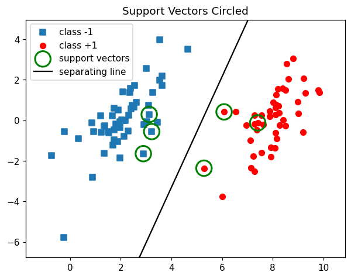 | 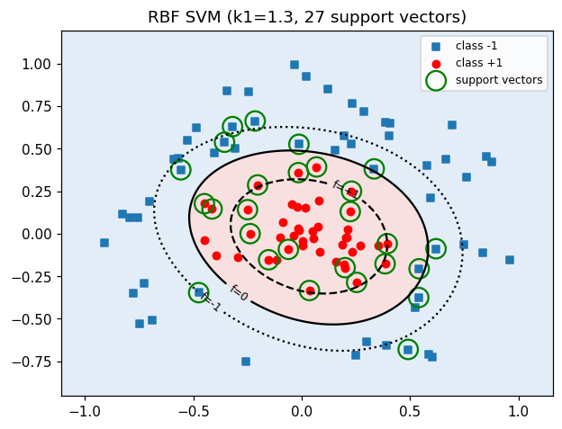 |  |

---

## 目录

1. [问题设定](#1-问题设定)
2. [函数间隔与几何间隔](#2-函数间隔与几何间隔)
3. [硬间隔 SVM：原始问题](#3-硬间隔-svm原始问题)
4. [拉格朗日对偶](#4-拉格朗日对偶)
5. [KKT 条件与支持向量](#5-kkt-条件与支持向量)
6. [软间隔 SVM 与参数 C](#6-软间隔-svm-与参数-c)
7. [核技巧](#7-核技巧)
8. [SMO 算法详细推导](#8-smo-算法详细推导)
9. [公式与代码对照表](#9-公式与代码对照表)
10. [实验结果](#10-实验结果)
11. [为什么书中 SMO 的支持向量不在 f=±1 上？](#11-为什么书中-smo-的支持向量不在-f1-上)
12. [项目结构与运行方法](#12-项目结构与运行方法)
13. [参考资料与致谢](#13-参考资料与致谢)

---

## 1. 问题设定

给定训练集

<p align="center"><picture><source media="(prefers-color-scheme: dark)" srcset="images/math/3b9173fbd1c5-dark.svg"></picture></p>

我们要找一个超平面 <picture><source media="(prefers-color-scheme: dark)" srcset="images/math/e91934a8bdbc-dark.svg">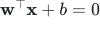</picture> 把两类分开，并用

<p align="center"><picture><source media="(prefers-color-scheme: dark)" srcset="images/math/67e2e4eb817b-dark.svg"></picture></p>

做预测。注意 SVM 的标签取 <picture><source media="(prefers-color-scheme: dark)" srcset="images/math/298dfbd4a3f8-dark.svg">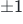</picture> 而不是 <picture><source media="(prefers-color-scheme: dark)" srcset="images/math/2c446791b22f-dark.svg"></picture>，这样 "分类正确" 可以统一写成 <picture><source media="(prefers-color-scheme: dark)" srcset="images/math/b138882328d2-dark.svg"></picture>，后面的推导会简洁很多。

能把线性可分数据分开的超平面有无穷多个。SVM 的核心思想是：**选择离两类样本都"最远"的那一个**，即最大化间隔（margin）。直觉上，间隔越大，对噪声和新样本的容忍度越高，泛化能力越好（统计学习理论中，间隔越大，VC 维上界越小）。

## 2. 函数间隔与几何间隔

**函数间隔**（functional margin）：

<p align="center"><picture><source media="(prefers-color-scheme: dark)" srcset="images/math/9414ff449586-dark.svg"></picture></p>

它为正表示分类正确，数值越大越"确信"。但它有个问题：把 <picture><source media="(prefers-color-scheme: dark)" srcset="images/math/2dd191a45786-dark.svg"></picture> 同时乘以 2，超平面不变，函数间隔却翻倍。所以函数间隔不能直接拿来最大化。

**几何间隔**（geometric margin）：点 <picture><source media="(prefers-color-scheme: dark)" srcset="images/math/6becae3a93ea-dark.svg"></picture> 到超平面的欧氏距离（带符号）

<p align="center"><picture><source media="(prefers-color-scheme: dark)" srcset="images/math/8605211cdc7f-dark.svg">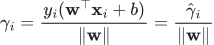</picture></p>

推导：设 <picture><source media="(prefers-color-scheme: dark)" srcset="images/math/08984fa3c6e1-dark.svg"></picture> 是 <picture><source media="(prefers-color-scheme: dark)" srcset="images/math/6becae3a93ea-dark.svg"></picture> 在超平面上的投影，则 <picture><source media="(prefers-color-scheme: dark)" srcset="images/math/e25e97b5fee0-dark.svg">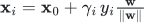</picture>。代入 <picture><source media="(prefers-color-scheme: dark)" srcset="images/math/d60deb11b3e7-dark.svg">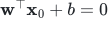</picture> 即得上式。几何间隔对 <picture><source media="(prefers-color-scheme: dark)" srcset="images/math/2dd191a45786-dark.svg"></picture> 的缩放不变。

整个数据集的间隔定义为所有样本几何间隔的最小值：<picture><source media="(prefers-color-scheme: dark)" srcset="images/math/3fab31b26b13-dark.svg"></picture>。

## 3. 硬间隔 SVM：原始问题

最大化间隔：

<p align="center"><picture><source media="(prefers-color-scheme: dark)" srcset="images/math/9378dbbed2f9-dark.svg"></picture></p>

由于 <picture><source media="(prefers-color-scheme: dark)" srcset="images/math/2dd191a45786-dark.svg"></picture> 可以任意缩放，我们**固定函数间隔 <picture><source media="(prefers-color-scheme: dark)" srcset="images/math/5fc54c651572-dark.svg">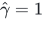</picture>**（这就是"<picture><source media="(prefers-color-scheme: dark)" srcset="images/math/c1d5a7640f93-dark.svg"></picture>"这两条间隔边界的来源）。于是最大化 <picture><source media="(prefers-color-scheme: dark)" srcset="images/math/0a33bd2c9070-dark.svg"></picture> 等价于最小化 <picture><source media="(prefers-color-scheme: dark)" srcset="images/math/093e01bb88a3-dark.svg"></picture>（平方和系数 <picture><source media="(prefers-color-scheme: dark)" srcset="images/math/c98465657c5c-dark.svg"></picture> 只是为了求导方便）：

<p align="center"><picture><source media="(prefers-color-scheme: dark)" srcset="images/math/65bcf073e3b0-dark.svg">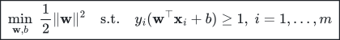</picture></p>

这是一个**凸二次规划**（目标是凸二次函数，约束是线性的），有唯一的最优 <picture><source media="(prefers-color-scheme: dark)" srcset="images/math/d66e77fa6570-dark.svg"></picture>。此时两条间隔边界 <picture><source media="(prefers-color-scheme: dark)" srcset="images/math/fe661af59adb-dark.svg"></picture> 之间的宽度为 <picture><source media="(prefers-color-scheme: dark)" srcset="images/math/b022aced1685-dark.svg"></picture>。

## 4. 拉格朗日对偶

为什么要转到对偶问题？两个原因：

1. 对偶问题只依赖样本之间的**内积** <picture><source media="(prefers-color-scheme: dark)" srcset="images/math/cd141d3c4844-dark.svg"></picture>，这让我们可以引入**核函数**（第 7 节）；
2. 对偶问题的变量个数是样本数 <picture><source media="(prefers-color-scheme: dark)" srcset="images/math/40febc1184c2-dark.svg"></picture>，且约束形式非常简单，适合用 SMO 这样的坐标式方法求解。

### 4.1 拉格朗日函数

对每个约束引入乘子 <picture><source media="(prefers-color-scheme: dark)" srcset="images/math/ddbed1ac64ab-dark.svg"></picture>：

<p align="center"><picture><source media="(prefers-color-scheme: dark)" srcset="images/math/96f56f97e140-dark.svg">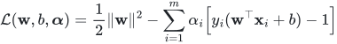</picture></p>

原始问题等价于 <picture><source media="(prefers-color-scheme: dark)" srcset="images/math/d14b1ac3b7a6-dark.svg"></picture>：若某个约束被违反，对应的 <picture><source media="(prefers-color-scheme: dark)" srcset="images/math/953a206703e5-dark.svg"></picture> 会让 <picture><source media="(prefers-color-scheme: dark)" srcset="images/math/76a794cad0b5-dark.svg"></picture>；若约束都满足，最大值就是 <picture><source media="(prefers-color-scheme: dark)" srcset="images/math/512ac31cb372-dark.svg"></picture>。

对偶问题是交换 min 与 max：<picture><source media="(prefers-color-scheme: dark)" srcset="images/math/9835f2705699-dark.svg"></picture>。由于原始问题是凸的且约束是线性的（满足 Slater 条件），**强对偶成立**，两者最优值相同。

### 4.2 对 w、b 求极小

<p align="center"><picture><source media="(prefers-color-scheme: dark)" srcset="images/math/ac4b9d58f973-dark.svg">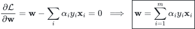</picture></p>

<p align="center"><picture><source media="(prefers-color-scheme: dark)" srcset="images/math/e3a5017ebdb8-dark.svg">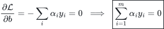</picture></p>

第一个式子说明：**<picture><source media="(prefers-color-scheme: dark)" srcset="images/math/9526068eb7a5-dark.svg"></picture> 是训练样本的线性组合**。代码中的 `calcWs` 就是在计算它。

### 4.3 对偶问题

把上面两式代回 <picture><source media="(prefers-color-scheme: dark)" srcset="images/math/8d91bb8b7fd4-dark.svg"></picture>：

<p align="center"><picture><source media="(prefers-color-scheme: dark)" srcset="images/math/422c6100c1a8-dark.svg">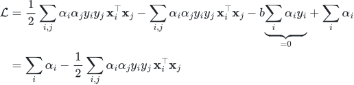</picture></p>

得到**对偶问题**：

<p align="center"><picture><source media="(prefers-color-scheme: dark)" srcset="images/math/80aaf3b346d6-dark.svg">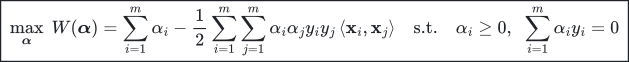</picture></p>

求出 <picture><source media="(prefers-color-scheme: dark)" srcset="images/math/edd30089d16a-dark.svg"></picture> 后，决策函数为

<p align="center"><picture><source media="(prefers-color-scheme: dark)" srcset="images/math/c95f587329f6-dark.svg">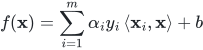</picture></p>

## 5. KKT 条件与支持向量

强对偶下，最优解必须满足 KKT 条件：

<p align="center"><picture><source media="(prefers-color-scheme: dark)" srcset="images/math/1a2de908e41b-dark.svg">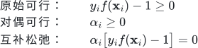</picture></p>

**互补松弛**是理解 SVM 的关键：对每个样本，要么 <picture><source media="(prefers-color-scheme: dark)" srcset="images/math/f97a7b72650a-dark.svg"></picture>，要么 <picture><source media="(prefers-color-scheme: dark)" srcset="images/math/69d22f5f04a4-dark.svg">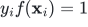</picture>。

- <picture><source media="(prefers-color-scheme: dark)" srcset="images/math/f97a7b72650a-dark.svg"></picture> 的样本对 <picture><source media="(prefers-color-scheme: dark)" srcset="images/math/9526068eb7a5-dark.svg"></picture> 毫无贡献，删掉它们，解不变；
- <picture><source media="(prefers-color-scheme: dark)" srcset="images/math/ea4b304dab54-dark.svg"></picture> 的样本必然恰好落在间隔边界 <picture><source media="(prefers-color-scheme: dark)" srcset="images/math/fe661af59adb-dark.svg"></picture> 上，它们**支撑起了整个超平面**，因此称为**支持向量**。

这就是 SVM 的**稀疏性**：最终模型只依赖少数支持向量。代码里用 `nonzero(alphas.A > 0)` 取出它们。

**求 b**：任取一个支持向量 <picture><source media="(prefers-color-scheme: dark)" srcset="images/math/14665a77d054-dark.svg"></picture>，由 <picture><source media="(prefers-color-scheme: dark)" srcset="images/math/35d3ed4ad260-dark.svg">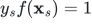</picture> 且 <picture><source media="(prefers-color-scheme: dark)" srcset="images/math/d16e6f38c343-dark.svg">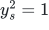</picture> 得

<p align="center"><picture><source media="(prefers-color-scheme: dark)" srcset="images/math/d4f62e9b2c0c-dark.svg">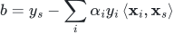</picture></p>

数值上更稳健的做法是对所有（非边界）支持向量求平均。

## 6. 软间隔 SVM 与参数 C

现实数据往往不是线性可分的，或者存在噪声/离群点。硬间隔要求所有点都在间隔外，此时无解或解很差。

### 6.1 引入松弛变量

允许每个样本有一定的"违约量" <picture><source media="(prefers-color-scheme: dark)" srcset="images/math/0fdfff515e4a-dark.svg"></picture>，但要为此付出代价 <picture><source media="(prefers-color-scheme: dark)" srcset="images/math/a0e32e6d0aed-dark.svg"></picture>：

<p align="center"><picture><source media="(prefers-color-scheme: dark)" srcset="images/math/40a0715e3817-dark.svg">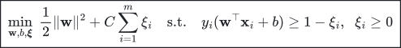</picture></p>

- <picture><source media="(prefers-color-scheme: dark)" srcset="images/math/30b0e5d98c87-dark.svg">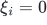</picture>：样本在间隔外（或间隔边界上）；
- <picture><source media="(prefers-color-scheme: dark)" srcset="images/math/520f3ceb4b48-dark.svg"></picture>：样本在间隔内，但仍分类正确；
- <picture><source media="(prefers-color-scheme: dark)" srcset="images/math/d393321595d4-dark.svg"></picture>：样本被分错。

### 6.2 软间隔的对偶

对两组约束分别引入 <picture><source media="(prefers-color-scheme: dark)" srcset="images/math/ddbed1ac64ab-dark.svg"></picture>、<picture><source media="(prefers-color-scheme: dark)" srcset="images/math/2134fee379e7-dark.svg"></picture>：

<p align="center"><picture><source media="(prefers-color-scheme: dark)" srcset="images/math/2713931def5b-dark.svg">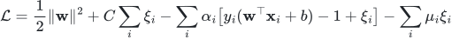</picture></p>

对 <picture><source media="(prefers-color-scheme: dark)" srcset="images/math/9526068eb7a5-dark.svg"></picture>、<picture><source media="(prefers-color-scheme: dark)" srcset="images/math/039279f12a91-dark.svg"></picture> 求导结果与硬间隔相同，多出一个：

<p align="center"><picture><source media="(prefers-color-scheme: dark)" srcset="images/math/a592cc7e881f-dark.svg">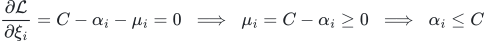</picture></p>

代回后 <picture><source media="(prefers-color-scheme: dark)" srcset="images/math/0e6e62d0ca5f-dark.svg">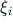</picture> 和 <picture><source media="(prefers-color-scheme: dark)" srcset="images/math/eac7e96f9505-dark.svg"></picture> 全部消掉，对偶问题与硬间隔**完全一样**，只是 <picture><source media="(prefers-color-scheme: dark)" srcset="images/math/538dd5bd0ab2-dark.svg"></picture> 多了一个上界：

<p align="center"><picture><source media="(prefers-color-scheme: dark)" srcset="images/math/7f08128053e3-dark.svg">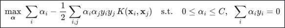</picture></p>

（这里已经把内积换成了核函数 <picture><source media="(prefers-color-scheme: dark)" srcset="images/math/220f1bb1ef27-dark.svg"></picture>，见第 7 节。）这个"盒约束" <picture><source media="(prefers-color-scheme: dark)" srcset="images/math/aa5ad47f3706-dark.svg"></picture> 就是代码里 `clipAlpha` 和 `L`、`H` 的来源。

### 6.3 软间隔的 KKT 条件

结合 <picture><source media="(prefers-color-scheme: dark)" srcset="images/math/67c6adeb603e-dark.svg">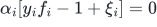</picture> 和 <picture><source media="(prefers-color-scheme: dark)" srcset="images/math/40d25709e5a4-dark.svg">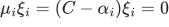</picture>，可以得到三种情况：

| <picture><source media="(prefers-color-scheme: dark)" srcset="images/math/538dd5bd0ab2-dark.svg"></picture> 的取值 | 推出的 <picture><source media="(prefers-color-scheme: dark)" srcset="images/math/923c6ce54b39-dark.svg"></picture> | 样本位置 | 是否支持向量 |
|---|---|---|---|
| <picture><source media="(prefers-color-scheme: dark)" srcset="images/math/f97a7b72650a-dark.svg"></picture> | <picture><source media="(prefers-color-scheme: dark)" srcset="images/math/1f4296a4564f-dark.svg"></picture> | 间隔边界之外（正确分类） | 否 |
| <picture><source media="(prefers-color-scheme: dark)" srcset="images/math/86a14814c614-dark.svg"></picture> | <picture><source media="(prefers-color-scheme: dark)" srcset="images/math/5d8d1afbdf9f-dark.svg">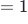</picture> | **恰好在 <picture><source media="(prefers-color-scheme: dark)" srcset="images/math/c1d5a7640f93-dark.svg"></picture> 上** | 是（"自由"支持向量） |
| <picture><source media="(prefers-color-scheme: dark)" srcset="images/math/c447138a2b15-dark.svg">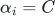</picture> | <picture><source media="(prefers-color-scheme: dark)" srcset="images/math/1c4b92c1f923-dark.svg"></picture> | 间隔内部，甚至被分错 | 是（"边界"支持向量） |

**这张表是检验求解器是否收敛的标准**：只有 <picture><source media="(prefers-color-scheme: dark)" srcset="images/math/c447138a2b15-dark.svg"></picture> 的支持向量才允许离开 <picture><source media="(prefers-color-scheme: dark)" srcset="images/math/c1d5a7640f93-dark.svg"></picture>。代码中的 KKT 检查写成误差形式：令 <picture><source media="(prefers-color-scheme: dark)" srcset="images/math/03f66da06923-dark.svg">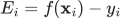</picture>，则 <picture><source media="(prefers-color-scheme: dark)" srcset="images/math/f95065ea8c89-dark.svg"></picture>，于是

- <picture><source media="(prefers-color-scheme: dark)" srcset="images/math/1a14916ccf58-dark.svg"></picture>（点在间隔内）却 <picture><source media="(prefers-color-scheme: dark)" srcset="images/math/27618722e3a2-dark.svg"></picture> → 违反 KKT；
- <picture><source media="(prefers-color-scheme: dark)" srcset="images/math/64b9110e60d5-dark.svg"></picture>（点在间隔外）却 <picture><source media="(prefers-color-scheme: dark)" srcset="images/math/ea4b304dab54-dark.svg"></picture> → 违反 KKT。

对应代码：

```python
if ((labelMat[i]*Ei < -toler) and (alphas[i] < C)) or ((labelMat[i]*Ei > toler) and (alphas[i] > 0)):
```

`toler` 是数值容差。

### 6.4 等价形式：合页损失

由约束可知最优时 <picture><source media="(prefers-color-scheme: dark)" srcset="images/math/ffe430f0f988-dark.svg">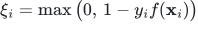</picture>，代回目标函数：

<p align="center"><picture><source media="(prefers-color-scheme: dark)" srcset="images/math/ce476810ba8a-dark.svg">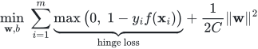</picture></p>

所以软间隔 SVM = **合页损失 + L2 正则**。<picture><source media="(prefers-color-scheme: dark)" srcset="images/math/ea8c30f955d8-dark.svg"></picture> 是正则强度的倒数：

- <picture><source media="(prefers-color-scheme: dark)" srcset="images/math/ea8c30f955d8-dark.svg"></picture> 大 → 强烈惩罚违约，接近硬间隔，间隔窄、容易过拟合；
- <picture><source media="(prefers-color-scheme: dark)" srcset="images/math/ea8c30f955d8-dark.svg"></picture> 小 → 允许更多违约，间隔宽、更平滑，可能欠拟合。

## 7. 核技巧

### 7.1 思想

对偶问题和决策函数里，样本只以内积 <picture><source media="(prefers-color-scheme: dark)" srcset="images/math/13d316901eef-dark.svg"></picture> 的形式出现。如果先用映射 <picture><source media="(prefers-color-scheme: dark)" srcset="images/math/6d7337607579-dark.svg"></picture> 把数据送到高维（甚至无穷维）特征空间，在那里做线性 SVM，就只需要计算 <picture><source media="(prefers-color-scheme: dark)" srcset="images/math/1a6854d96756-dark.svg"></picture>。**核函数**直接给出这个内积，而不必显式计算 <picture><source media="(prefers-color-scheme: dark)" srcset="images/math/92203ba9b064-dark.svg"></picture>：

<p align="center"><picture><source media="(prefers-color-scheme: dark)" srcset="images/math/7c123f928d61-dark.svg"></picture></p>

于是决策函数变为

<p align="center"><picture><source media="(prefers-color-scheme: dark)" srcset="images/math/db72aad47d97-dark.svg">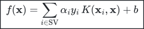</picture></p>

它在原空间里是非线性的。代码 `testRbf` 中的预测就是这一行：

```python
predict = kernelEval.T * multiply(labelSV, alphas[svInd]) + b
```

### 7.2 什么函数能当核？（Mercer 定理）

<picture><source media="(prefers-color-scheme: dark)" srcset="images/math/220f1bb1ef27-dark.svg"></picture> 是合法核，当且仅当对任意有限样本集，**核矩阵（Gram 矩阵）<picture><source media="(prefers-color-scheme: dark)" srcset="images/math/4c6f695a83e0-dark.svg"></picture> 对称半正定**。这保证了对偶问题仍是凸的（目标函数是凹的），有全局最优。

### 7.3 本项目用到的核

`kernelTrans(X, A, kTup)` 支持两种核：

| 核 | 公式 | 代码参数 |
|---|---|---|
| 线性核 | <picture><source media="(prefers-color-scheme: dark)" srcset="images/math/18a895f3fcbb-dark.svg">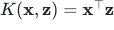</picture> | `('lin', 0)` |
| 高斯 RBF 核 | <picture><source media="(prefers-color-scheme: dark)" srcset="images/math/25564b1c0b71-dark.svg">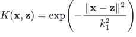</picture> | `('rbf', k1)` |

注意：书中的 RBF 写法分母是 <picture><source media="(prefers-color-scheme: dark)" srcset="images/math/77f52a0779ed-dark.svg"></picture>，而不是教科书常见的 <picture><source media="(prefers-color-scheme: dark)" srcset="images/math/00f93f68fafa-dark.svg"></picture>。换到 scikit-learn 时，对应 `gamma = 1 / k1**2`（见 `testRbfSklearn`）。

**RBF 核对应无穷维特征空间。** 以一维为例（取 <picture><source media="(prefers-color-scheme: dark)" srcset="images/math/f2e8d35b2f41-dark.svg">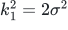</picture> 记号）：

<p align="center"><picture><source media="(prefers-color-scheme: dark)" srcset="images/math/1d8c0cc50627-dark.svg">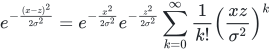</picture></p>

展开后每一项都是 <picture><source media="(prefers-color-scheme: dark)" srcset="images/math/ceb4e508e3dd-dark.svg"></picture> 与 <picture><source media="(prefers-color-scheme: dark)" srcset="images/math/577361e17d69-dark.svg"></picture> 的乘积，即 <picture><source media="(prefers-color-scheme: dark)" srcset="images/math/b4637e4e28ec-dark.svg"></picture> 含有所有阶的多项式特征。

**<picture><source media="(prefers-color-scheme: dark)" srcset="images/math/d0097656ecce-dark.svg"></picture> 的作用**（带宽）：

- <picture><source media="(prefers-color-scheme: dark)" srcset="images/math/d0097656ecce-dark.svg"></picture> 小 → 核衰减快，每个支持向量只影响很小的邻域，边界弯曲复杂，支持向量多，易过拟合；
- <picture><source media="(prefers-color-scheme: dark)" srcset="images/math/d0097656ecce-dark.svg"></picture> 大 → 核很平，边界接近线性/低阶多项式，易欠拟合。

## 8. SMO 算法详细推导

对偶问题是一个有 <picture><source media="(prefers-color-scheme: dark)" srcset="images/math/40febc1184c2-dark.svg"></picture> 个变量的二次规划。通用 QP 求解器需要存储 <picture><source media="(prefers-color-scheme: dark)" srcset="images/math/37c5e7209fe0-dark.svg"></picture> 的核矩阵并做矩阵分解，规模一大就吃不消。**SMO（Sequential Minimal Optimization，Platt 1998）** 的思路是：每次只优化**两个**变量，其余固定，而两变量子问题有**解析解**。

### 8.1 为什么是两个变量？

约束 <picture><source media="(prefers-color-scheme: dark)" srcset="images/math/5aaf9b843ee9-dark.svg">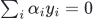</picture> 意味着：如果只改一个 <picture><source media="(prefers-color-scheme: dark)" srcset="images/math/538dd5bd0ab2-dark.svg"></picture>，其它都不动，这个等式就被破坏了。所以最少要同时改两个。

### 8.2 两变量子问题

选定 <picture><source media="(prefers-color-scheme: dark)" srcset="images/math/9d986f45f825-dark.svg"></picture>，其余固定。等式约束变为

<p align="center"><picture><source media="(prefers-color-scheme: dark)" srcset="images/math/25876b78d8d0-dark.svg"></picture></p>

两边乘以 <picture><source media="(prefers-color-scheme: dark)" srcset="images/math/a60eb02914d8-dark.svg"></picture>，记 <picture><source media="(prefers-color-scheme: dark)" srcset="images/math/8fea96b463b3-dark.svg">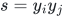</picture>：

<p align="center"><picture><source media="(prefers-color-scheme: dark)" srcset="images/math/047c82dd563b-dark.svg"></picture></p>

记 <picture><source media="(prefers-color-scheme: dark)" srcset="images/math/b7b43115ad97-dark.svg"></picture>，<picture><source media="(prefers-color-scheme: dark)" srcset="images/math/5f6d1e778627-dark.svg">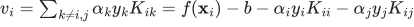</picture>。目标函数中只与 <picture><source media="(prefers-color-scheme: dark)" srcset="images/math/9d986f45f825-dark.svg"></picture> 有关的部分是

<p align="center"><picture><source media="(prefers-color-scheme: dark)" srcset="images/math/67a62baee73c-dark.svg"></picture></p>

把 <picture><source media="(prefers-color-scheme: dark)" srcset="images/math/f0b70f6ae304-dark.svg">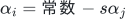</picture> 代入，<picture><source media="(prefers-color-scheme: dark)" srcset="images/math/9c497dcfed79-dark.svg"></picture> 变成 <picture><source media="(prefers-color-scheme: dark)" srcset="images/math/66f00ef75539-dark.svg"></picture> 的一元二次函数。

### 8.3 未剪辑的最优解

对 <picture><source media="(prefers-color-scheme: dark)" srcset="images/math/66f00ef75539-dark.svg"></picture> 求导并令其为零，再把 <picture><source media="(prefers-color-scheme: dark)" srcset="images/math/3f35274e79b3-dark.svg"></picture> 用旧的 <picture><source media="(prefers-color-scheme: dark)" srcset="images/math/6edf0dc542f6-dark.svg"></picture> 表示，整理后得到一个非常漂亮的结果。定义

<p align="center"><picture><source media="(prefers-color-scheme: dark)" srcset="images/math/3032b98de030-dark.svg"></picture></p>

则

<p align="center"><picture><source media="(prefers-color-scheme: dark)" srcset="images/math/1bfed200f73c-dark.svg">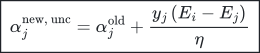</picture></p>

<picture><source media="(prefers-color-scheme: dark)" srcset="images/math/9c497dcfed79-dark.svg"></picture> 对 <picture><source media="(prefers-color-scheme: dark)" srcset="images/math/66f00ef75539-dark.svg"></picture> 的二阶导是 <picture><source media="(prefers-color-scheme: dark)" srcset="images/math/d71f1068f06c-dark.svg"></picture>，所以 <picture><source media="(prefers-color-scheme: dark)" srcset="images/math/517f5b3c7f18-dark.svg"></picture> 时 <picture><source media="(prefers-color-scheme: dark)" srcset="images/math/9c497dcfed79-dark.svg"></picture> 是开口向下的抛物线，上面的驻点就是最大值。<picture><source media="(prefers-color-scheme: dark)" srcset="images/math/49ce6ef5c9dc-dark.svg">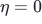</picture>（两个样本在特征空间重合）时退化，代码直接跳过这一对。

> **代码约定**：代码中 `eta = 2*K[i,j] - K[i,i] - K[j,j]`，即 <picture><source media="(prefers-color-scheme: dark)" srcset="images/math/d71f1068f06c-dark.svg"></picture>，所以条件写成 `if eta >= 0: return 0`，更新写成 `alphas[j] -= labelMat[j]*(Ei - Ej)/eta`，与上式等价。

### 8.4 剪辑：满足盒约束

<picture><source media="(prefers-color-scheme: dark)" srcset="images/math/72fad24dfecf-dark.svg"></picture> 必须同时落在正方形 <picture><source media="(prefers-color-scheme: dark)" srcset="images/math/4635593b2369-dark.svg">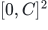</picture> 内，且在直线 <picture><source media="(prefers-color-scheme: dark)" srcset="images/math/835f6f445f11-dark.svg"></picture> 上，所以 <picture><source media="(prefers-color-scheme: dark)" srcset="images/math/66f00ef75539-dark.svg"></picture> 只能在一条线段上移动，范围记为 <picture><source media="(prefers-color-scheme: dark)" srcset="images/math/74b633720b13-dark.svg"></picture>：

- 当 <picture><source media="(prefers-color-scheme: dark)" srcset="images/math/bbf8d874e7e4-dark.svg">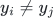</picture>（<picture><source media="(prefers-color-scheme: dark)" srcset="images/math/e3d6473b4c7d-dark.svg">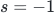</picture>，直线 <picture><source media="(prefers-color-scheme: dark)" srcset="images/math/48d8f5902671-dark.svg"></picture>）：

<p align="center"><picture><source media="(prefers-color-scheme: dark)" srcset="images/math/c44e675adec6-dark.svg"></picture></p>

- 当 <picture><source media="(prefers-color-scheme: dark)" srcset="images/math/07bbdb70f5c4-dark.svg"></picture>（<picture><source media="(prefers-color-scheme: dark)" srcset="images/math/078b2fd83b14-dark.svg">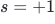</picture>，直线 <picture><source media="(prefers-color-scheme: dark)" srcset="images/math/12d4e29f061b-dark.svg">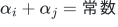</picture>）：

<p align="center"><picture><source media="(prefers-color-scheme: dark)" srcset="images/math/db03bc72273f-dark.svg"></picture></p>

然后剪辑：

<p align="center"><picture><source media="(prefers-color-scheme: dark)" srcset="images/math/4920f685e370-dark.svg">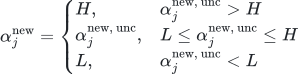</picture></p>

这就是 `clipAlpha(aj, H, L)`。若 <picture><source media="(prefers-color-scheme: dark)" srcset="images/math/7ca6587e6589-dark.svg"></picture>，线段退化成一个点，无法优化，跳过。

### 8.5 更新 αᵢ

由等式约束保持不变：

<p align="center"><picture><source media="(prefers-color-scheme: dark)" srcset="images/math/85c021292ccc-dark.svg"></picture></p>

对应 `alphas[i] += labelMat[j]*labelMat[i]*(alphaJold - alphas[j])`。

### 8.6 更新 b

记 <picture><source media="(prefers-color-scheme: dark)" srcset="images/math/cb9558ac5ff8-dark.svg"></picture>，<picture><source media="(prefers-color-scheme: dark)" srcset="images/math/8e90a0bc209f-dark.svg"></picture> 同理。更新后 <picture><source media="(prefers-color-scheme: dark)" srcset="images/math/2d762a85c9b1-dark.svg"></picture> 的变化为

<p align="center"><picture><source media="(prefers-color-scheme: dark)" srcset="images/math/2bf2bd4290b5-dark.svg"></picture></p>

如果 <picture><source media="(prefers-color-scheme: dark)" srcset="images/math/cca161e474b2-dark.svg"></picture>，由 KKT 它应恰好在间隔边界上，即 <picture><source media="(prefers-color-scheme: dark)" srcset="images/math/d8d68dd39a76-dark.svg"></picture>。利用 <picture><source media="(prefers-color-scheme: dark)" srcset="images/math/c867208c2843-dark.svg"></picture> 解出

<p align="center"><picture><source media="(prefers-color-scheme: dark)" srcset="images/math/747d50cb88fb-dark.svg"></picture></p>

同理由 <picture><source media="(prefers-color-scheme: dark)" srcset="images/math/b919bf53a669-dark.svg"></picture>：

<p align="center"><picture><source media="(prefers-color-scheme: dark)" srcset="images/math/f0f0ea9a7107-dark.svg"></picture></p>

取值规则：

<p align="center"><picture><source media="(prefers-color-scheme: dark)" srcset="images/math/3a1995619760-dark.svg"></picture></p>

与 `innerL` 中的 `b1`、`b2` 逐项对应。

### 8.7 怎么选这两个变量？（启发式）

SMO 的收敛速度主要取决于变量选择。

**外层循环——选 <picture><source media="(prefers-color-scheme: dark)" srcset="images/math/538dd5bd0ab2-dark.svg"></picture>**（`smoP`）：

- 在"遍历全部样本"和"只遍历非边界样本 <picture><source media="(prefers-color-scheme: dark)" srcset="images/math/86a14814c614-dark.svg"></picture>"之间交替进行；
- 非边界样本最可能违反 KKT，也最可能在优化中移动，所以大部分时间花在它们上面；
- 当非边界样本一轮下来没有任何更新，再遍历一次全集；全集也没有更新时停止。

**内层循环——选 <picture><source media="(prefers-color-scheme: dark)" srcset="images/math/66f00ef75539-dark.svg"></picture>**（`selectJ`）：

由 8.3 节，步长正比于 <picture><source media="(prefers-color-scheme: dark)" srcset="images/math/ab54c94e7ad6-dark.svg"></picture>，所以选**使 <picture><source media="(prefers-color-scheme: dark)" srcset="images/math/ab54c94e7ad6-dark.svg"></picture> 最大的 <picture><source media="(prefers-color-scheme: dark)" srcset="images/math/176386157f95-dark.svg"></picture>**，让每一步尽可能走得远。为了不每次都重新计算所有 <picture><source media="(prefers-color-scheme: dark)" srcset="images/math/fc625b93e803-dark.svg"></picture>，代码维护了误差缓存 `eCache`（第一列是有效标志，第二列是 <picture><source media="(prefers-color-scheme: dark)" srcset="images/math/fc625b93e803-dark.svg"></picture>），每次更新 <picture><source media="(prefers-color-scheme: dark)" srcset="images/math/29ab8b950533-dark.svg"></picture> 后调用 `updateEk` 刷新。

**简化版 SMO**（`smoSimple`）：外层顺序遍历所有样本，内层用 `selectJrand` **随机**选 <picture><source media="(prefers-color-scheme: dark)" srcset="images/math/176386157f95-dark.svg"></picture>；当连续 `maxIter` 轮没有任何更新时停止。易懂，但在大数据上很慢。

### 8.8 完整流程

```
初始化 α = 0, b = 0
repeat:
    对外层选出的每个 i:
        计算 E_i；若 i 不违反 KKT（在容差 toler 内），跳过
        用 |E_i − E_j| 最大的启发式选 j，计算 E_j
        计算 L, H；若 L == H 跳过
        计算 η；若 η ≤ 0 跳过
        α_j ← clip(α_j + y_j(E_i − E_j)/η, L, H)
        若 α_j 变化太小，跳过
        α_i ← α_i + y_i y_j (α_j_old − α_j)
        按 8.6 节更新 b，刷新误差缓存
until 一整轮没有 α 被更新 或 达到 maxIter
```

## 9. 公式与代码对照表

| 数学对象 | 公式 | 代码位置（`svmMLiA.py`） |
|---|---|---|
| 核函数 | <picture><source media="(prefers-color-scheme: dark)" srcset="images/math/37ffa485c824-dark.svg"></picture> | `kernelTrans` |
| 核矩阵 | <picture><source media="(prefers-color-scheme: dark)" srcset="images/math/4c6f695a83e0-dark.svg"></picture> | `optStruct.K`（初始化时一次算好） |
| 预测误差 | <picture><source media="(prefers-color-scheme: dark)" srcset="images/math/2758c0bae2cd-dark.svg"></picture> | `calcEk`、`eCache`、`updateEk` |
| KKT 违反检查 | 第 6.3 节 | `innerL` / `smoSimple` 开头的 `if` |
| 选第二个变量 | <picture><source media="(prefers-color-scheme: dark)" srcset="images/math/414ba25e921a-dark.svg"></picture> | `selectJ`（随机版 `selectJrand`） |
| 盒约束区间 | <picture><source media="(prefers-color-scheme: dark)" srcset="images/math/b80564c13ae8-dark.svg"></picture> | `innerL` 中的 `L`、`H` |
| 二阶导 | <picture><source media="(prefers-color-scheme: dark)" srcset="images/math/4888c134ceed-dark.svg"></picture> | `eta` |
| 剪辑 | <picture><source media="(prefers-color-scheme: dark)" srcset="images/math/9c14cafbffb8-dark.svg"></picture> | `clipAlpha` |
| 偏置 | <picture><source media="(prefers-color-scheme: dark)" srcset="images/math/385dc380dce4-dark.svg"></picture> | `b1`、`b2` |
| 外层循环 | 全集 / 非边界交替 | `smoP` |
| 权重向量（线性核） | <picture><source media="(prefers-color-scheme: dark)" srcset="images/math/f1f6bc06bad3-dark.svg"></picture> | `calcWs` |
| 决策函数 | <picture><source media="(prefers-color-scheme: dark)" srcset="images/math/c4ecda95166b-dark.svg"></picture> | `testRbf`、`testDigits`、`plotRbf` |

另外，文件后半部分的 `optStructK` / `innerLK` / `smoPK` 是**不使用核缓存**的线性版本，直接用 `X[i,:]*X[j,:].T` 计算内积，便于对照理解。

## 10. 实验结果

> SMO 选第一个 <picture><source media="(prefers-color-scheme: dark)" srcset="images/math/176386157f95-dark.svg"></picture> 时有随机性，每次运行的支持向量数可能略有不同。

### 10.1 线性可分数据（`testSet.txt`）

`smoP(dataArr, labelArr, C=0.6, toler=0.001, maxIter=40)`，线性核。一次运行得到 6 个支持向量，

<p align="center"><picture><source media="(prefers-color-scheme: dark)" srcset="images/math/bb2da262a815-dark.svg"></picture></p>

分隔线为 <picture><source media="(prefers-color-scheme: dark)" srcset="images/math/001d927e4792-dark.svg"></picture>（左上图）。

### 10.2 非线性数据（`testSetRBF.txt` 训练，`testSetRBF2.txt` 测试）

数据是两个同心区域（内圈 +1，外环 −1），线性不可分。RBF 核，<picture><source media="(prefers-color-scheme: dark)" srcset="images/math/e8b0780b2b01-dark.svg"></picture>：

| 求解器 | C | 支持向量数 | 支持向量的 <picture><source media="(prefers-color-scheme: dark)" srcset="images/math/f1ba647d1700-dark.svg"></picture> | 训练错误率 | 测试错误率 |
|---|---|---|---|---|---|
| 书中 `smoP`（`testRbf`） | 200 | 23 ~ 27 | 约 −0.08 ~ 2.0（不收敛） | ~1% | ~2% |
| scikit-learn `SVC`（`testRbfSklearn`） | 200 | 7（其中 1 个 <picture><source media="(prefers-color-scheme: dark)" srcset="images/math/d7819390e3ae-dark.svg"></picture>） | 0.72 ~ 1.00 | 0% | 5% |
| scikit-learn `SVC`（`testRbfSklearn`） | 500 | **5（全部 <picture><source media="(prefers-color-scheme: dark)" srcset="images/math/f559d21d2812-dark.svg"></picture>）** | **全部 = 1.0000** | 0% | 4% |

图中实线为决策边界 <picture><source media="(prefers-color-scheme: dark)" srcset="images/math/176acb3aff50-dark.svg"></picture>，虚线 / 点线为间隔边界 <picture><source media="(prefers-color-scheme: dark)" srcset="images/math/2981cb375c46-dark.svg"></picture> / <picture><source media="(prefers-color-scheme: dark)" srcset="images/math/121b14aba02e-dark.svg"></picture>，绿圈为支持向量。在 scikit-learn 的结果（右上图）中，**每个支持向量都精确落在 <picture><source media="(prefers-color-scheme: dark)" srcset="images/math/edc8606a64a5-dark.svg"></picture> 上**，与第 6.3 节的 KKT 表完全一致。

### 10.3 手写数字识别（`digits/`）

32×32 的二值图像展开成 1024 维向量。任务是二分类：数字 9 记为 −1，其余数字记为 +1。训练集 402 张，测试集 186 张。`testDigits(('rbf', k1))`，C=200：

| <picture><source media="(prefers-color-scheme: dark)" srcset="images/math/d0097656ecce-dark.svg"></picture> | 支持向量数 | 训练错误率 | 测试错误率 | 说明 |
|---|---|---|---|---|
| 0.1 | 402（全部样本） | 0% | 52.2% | 核太窄，每个样本只"记住"自己，严重过拟合 |
| 5 | 402 | 0% | 3.2% | 仍然过拟合 |
| **10** | **132** | **0%** | **0.5%** | 本次实验中最好 |
| 50 | 31 | 1.5% | 2.7% | 核较宽，边界更平滑 |
| 100 | 34 | 0.5% | 1.1% | |

规律与第 7.3 节一致：<picture><source media="(prefers-color-scheme: dark)" srcset="images/math/d0097656ecce-dark.svg"></picture> 太小 → 几乎所有样本都成为支持向量、训练集完美但测试集很差；<picture><source media="(prefers-color-scheme: dark)" srcset="images/math/d0097656ecce-dark.svg"></picture> 增大 → 支持向量减少，模型更平滑。

## 11. 为什么书中 SMO 的支持向量不在 f=±1 上？

对比上面两张 RBF 图会发现：书中 SMO 找到的二十多个支持向量很多既不在 <picture><source media="(prefers-color-scheme: dark)" srcset="images/math/edc8606a64a5-dark.svg"></picture> 上，又没有一个 <picture><source media="(prefers-color-scheme: dark)" srcset="images/math/538dd5bd0ab2-dark.svg"></picture> 达到 <picture><source media="(prefers-color-scheme: dark)" srcset="images/math/ea8c30f955d8-dark.svg"></picture>。按第 6.3 节的 KKT 表，这说明**算法没有收敛到最优解**。用书中参数跑一次，逐个检查支持向量：

- 没有一个 <picture><source media="(prefers-color-scheme: dark)" srcset="images/math/c447138a2b15-dark.svg"></picture>，按理所有支持向量都应满足 <picture><source media="(prefers-color-scheme: dark)" srcset="images/math/6aa92f350754-dark.svg"></picture>；
- 实际上 <picture><source media="(prefers-color-scheme: dark)" srcset="images/math/f1ba647d1700-dark.svg"></picture> 分布在约 −0.08 到 2.0 之间，只有最后一次更新的两个点恰好等于 1；
- 还有十几个 <picture><source media="(prefers-color-scheme: dark)" srcset="images/math/f97a7b72650a-dark.svg"></picture> 的点 <picture><source media="(prefers-color-scheme: dark)" srcset="images/math/a98ccfe967e9-dark.svg"></picture>，它们本应成为支持向量。

原因在于书中实现做了简化：

1. **停止条件过宽**：只要"一轮里没有任何一对 <picture><source media="(prefers-color-scheme: dark)" srcset="images/math/29ab8b950533-dark.svg"></picture> 被更新"就停止，而不是检查所有样本都在容差内满足 KKT。
2. **第二个变量没有后备方案**：`innerL` 在 `L == H`、`eta >= 0` 或 "j not moving enough" 时直接返回 0。Platt 原论文中，这时会依次尝试其他非边界样本、再尝试全部样本作为 <picture><source media="(prefers-color-scheme: dark)" srcset="images/math/176386157f95-dark.svg"></picture>，直到找到能产生进展的一对。书中只试 `selectJ` 选出的那一个，导致违反 KKT 的 <picture><source media="(prefers-color-scheme: dark)" srcset="images/math/9743da3722b5-dark.svg"></picture> 被"卡住"，外层循环误以为已收敛。
3. **b 的估计不稳**：<picture><source media="(prefers-color-scheme: dark)" srcset="images/math/039279f12a91-dark.svg"></picture> 只由最后一次更新的那一对决定，而不是在所有自由支持向量上平均。

scikit-learn 的 `SVC` 底层是 libsvm，它用"最大违反对"（maximal violating pair，基于梯度/二阶信息）选择工作集，并以 KKT 违反量小于 `tol` 作为停止条件，所以能收敛到真正的最优解。

**结论**：书中代码非常适合理解 SMO 的每一步更新，但不应把它的输出当作精确的 SVM 解；需要精确解时用 libsvm / scikit-learn。

## 12. 项目结构与运行方法

```
.
├── svmMLiA.py          # 全部算法与实验代码
├── Ch06.ipynb          # 交互式 notebook
├── testSet.txt         # 线性可分二维数据
├── testSetRBF.txt      # 非线性二维数据（训练）
├── testSetRBF2.txt     # 非线性二维数据（测试）
├── digits/
│   ├── trainingDigits/ # 手写数字训练集（文件名 "数字_序号.txt"）
│   └── testDigits/     # 手写数字测试集
├── EXTRAS/             # 书中画示意图 / 生成数据的辅助脚本
├── images/             # README 用图（images/math/ 为自动生成的公式 SVG）
├── README.src.md       # README 源文件（公式为 LaTeX，修改请编辑此文件）
└── tools/
    └── render_math.mjs # 把 README.src.md 中的公式渲染成 SVG 并生成 README.md
```

README 中的公式是用 MathJax 在本地渲染好的 SVG 图片，这样浏览器的网页翻译不会把公式里的 `max`、`\xi` 等误翻译。修改 README 时编辑 `README.src.md`，然后运行：

```bash
cd tools && npm install && node render_math.mjs
```

**依赖**：Python 3、NumPy（已兼容 NumPy 2）、Matplotlib；`testRbfSklearn` 额外需要 scikit-learn。

```bash
pip install numpy matplotlib scikit-learn
```

**运行**：

```bash
# 直接运行：默认执行手写数字实验 testDigits(('rbf', 100))
python svmMLiA.py

# 运行其他实验
python -c "import svmMLiA as s; d,l=s.loadDataSet('testSet.txt'); b,a=s.smoP(d,l,0.6,0.001,40); s.plotSupportVectors(d,l,a,b)"
python -c "import svmMLiA as s; s.testRbf(1.3)"         # 书中 SMO + RBF 核
python -c "import svmMLiA as s; s.testRbfSklearn()"     # scikit-learn 对照
python -c "import svmMLiA as s; s.testDigits(('rbf', 10))"
```

数据路径相对于脚本所在目录解析，可以从任意工作目录运行。

> 注意：`EXTRAS/plotRBF.py` 会**重新随机生成并覆盖** `testSetRBF2.txt`。

## 13. 参考资料与致谢

- Peter Harrington. *Machine Learning in Action*. Manning, 2012. 第 6 章。本项目代码基于该书的配套源码（Python 3 移植版），并做了 NumPy 2 兼容、路径修复、可视化和 scikit-learn 对照等改动。
- John C. Platt. *Sequential Minimal Optimization: A Fast Algorithm for Training Support Vector Machines*. Microsoft Research Technical Report MSR-TR-98-14, 1998.
- Corinna Cortes, Vladimir Vapnik. *Support-Vector Networks*. Machine Learning, 20(3): 273–297, 1995.
- Chih-Chung Chang, Chih-Jen Lin. *LIBSVM: A Library for Support Vector Machines*. ACM TIST, 2011.
- 李航.《统计学习方法》第 7 章「支持向量机」。
